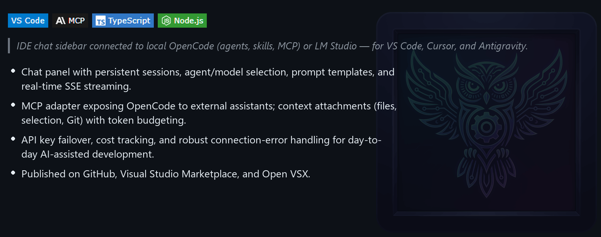
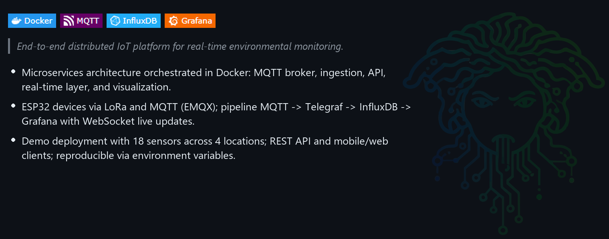
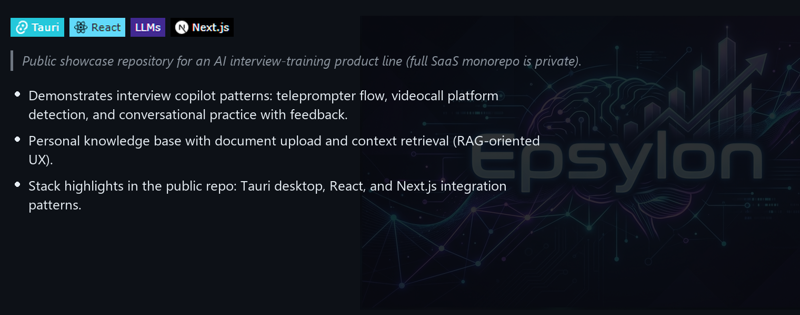
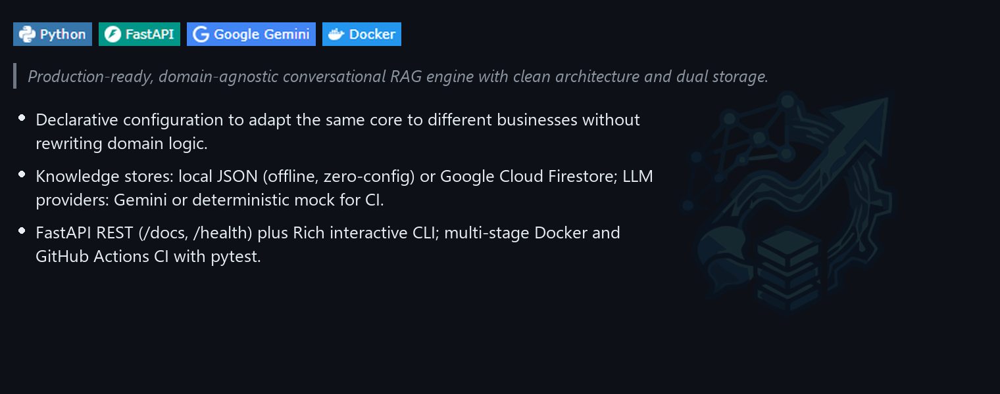

  

  

  
  
  
  

---

## Professional Profile

Backend Developer with a track record in high-responsibility corporate environments — combining solid backend work (Python, Java) with frontend capabilities (React) and infrastructure management. I bring the operational rigor of years in corporate IT together with modern product development: clean code, scalable architecture, and production systems — from API integrations to critical system maintenance.

Looking to join a backend team where I can contribute software, AI, infrastructure, and real business experience.

---

## Key Focus Areas

* **Distributed & Event-Driven Systems:** Real-time ingestion pipelines with MQTT, WebSockets, InfluxDB, and microservices.
* **Agentic AI & Developer Tooling:** MCP servers, LLM integrations, and IDE extensions for AI-assisted development workflows.
* **Corporate IT & Ecommerce:** Payment gateway integrations (Adyen, PayPal, Amazon Pay), process automation, business dashboards, and production infrastructure.

---

## Tech Stack

<b>AI & Agentic Development</b>

  
  
  
  
  

<b>Backend & Systems</b>

  
  
  
  
  
  
  
  
  
  
  
  
  

<b>Databases & Analytics</b>

  
  
  
  
  
  
  

<b>DevOps, Cloud & Infra</b>

  
  
  
  
  
  
  
  
  
  

<b>Frontend & Mobile (Complementary)</b>

  
  
  
  
  

---

## Featured Projects

### OpenCode Chat Panel (opencode-mcp)

**[GitHub](https://github.com/Pacoaldev/opencode-mcp)** · **[VS Marketplace](https://marketplace.visualstudio.com/items?itemName=Pacoaldev.opencode-mcp-vscode)** · **[Open VSX](https://open-vsx.org/extension/Pacoaldev/opencode-mcp-vscode)**

 

---

### Medusse IoT

**[GitHub](https://github.com/Pacoaldev/medusse-show)**

 

---

### Epsylon

**[GitHub](https://github.com/Pacoaldev/Epsylon-show)**

 

---

### Universal RAG Assistant Engine

**[GitHub](https://github.com/Pacoaldev/Universal-RAG-assistant-engine)**

 

---

## More projects

  
  
  
  
  

> *Five additional public repos — **BypasserAI**, **Citabot** (Google Play), **Applydash**, **TrainerExpert**, and **APIpnot**. Use the control below to expand or collapse full write-ups.*

<strong>Project details — click to expand or collapse</strong>

 

### BypasserAI

**[GitHub](https://github.com/Pacoaldev/BypasserAI)**

  
  
  

> *Git pre-commit hook and CLI that humanizes AI-shaped code before it lands in history.*

* Local heuristic scorer on staged files (no API on clean commits); OpenAI-compatible rewrite only above threshold.
* Language-aware profiles (JS/TS, Python, Go, Rust, Java, and more); smart rewrite scope (file, diff hunks, or chunks).
* Safety guards, `.bak` rollback, parallel rewrites, and optional Windows toasts — agent-friendly via `AGENTS.md`.

---

### Citabot

**[GitHub](https://github.com/Pacoaldev/Citabot)** · **[Live API](https://citabot.onrender.com)** · **[Google Play](https://play.google.com/store/apps/details?id=com.paco.citabot&hl=es)**

  
  
  
  

> *Android app published on Google Play that automates searching for available appointments.*

* FastAPI scraping backend with push notifications via Firebase Cloud Messaging.
* Background monitoring with 30-minute cache and rate limiting to protect external services.
* Custom API for monitoring requests, user preferences, and search state; CORS restricted for security.
* Backend deployed on Render with environment-based configuration.

---

### Applydash

**[GitHub](https://github.com/Pacoaldev/APPLYDASH)** · **[Live](https://applydash.vercel.app)**

  
  
  
  

> *Job application tracking dashboard in production on Vercel.*

* Next.js 16 app with Prisma and Supabase (auth, realtime data); Kanban board with drag-and-drop.
* Browser extension for cross-portal capture (LinkedIn, Indeed, InfoJobs, and others).
* CSV import/export, matching engine, and metrics to reduce manual follow-up during job search.

---

### TrainerExpert

**[GitHub](https://github.com/Pacoaldev/TrainerExpert)**

  
  
  

> *Technical interview simulator with 8 real-world scenarios.*

* PWA with mobile microphone support and local Node.js proxy for Gemini/NVIDIA APIs without CORS conflicts.
* Open-source (MIT) — clone, add your API key, and train with your own profile.

---

### APIpnot

**[GitHub](https://github.com/Pacoaldev/APIpnot)**

  
  
  

> *Data platform for real-time extraction and visualization of Spanish real estate prices.*

* Full data pipeline: scraping and API consumption, Pandas cleaning/aggregation, interactive Streamlit + Plotly dashboard.
* Modular architecture separating ingestion, processing, and visualization.

---

## Professional Experience

**Stack & Flow** — React / Design System Contributor · *2025 – 2026*

* Collaborative development of a React + TypeScript Design System with reusable, composable, accessible components (Atomic Design).
* Component APIs with TypeScript typing; documentation via Storybook.
* Git workflow, pull requests, and code reviews.

**Lladró S.A.** — Ecommerce & IT Specialist · *2020 – 2024*

* Business process automation and internal tools, reducing operational errors and management time.
* Payment gateway integration (Adyen, PayPal, Amazon Pay) with testing, security, and transaction monitoring.
* Data-driven business dashboards connecting ERP, ecommerce, and logistics sources.
* Frontend work (HTML, CSS, Tailwind) on Magento; collaboration with business teams on technical requirements.

**Lladró S.A.** — IT Support Lead · *2010 – 2020*

* Led the IT help desk (CAU): user support, incident prioritization, and management communication.
* Infrastructure, networking, and security: servers, backups, and access policies for corporate environments.
* Internal process automation (inventory, user onboarding/offboarding, reporting).

---

## Education & Certifications

**Higher Vocational Training in Web Application Development (DAW)** — IES José Rodrigo Botet · Grade: 9/10 (2 honors) · Final project: 10/10

| Certification | Issuer |
|---|---|
| [Claude Code in Action](https://verify.skilljar.com/c/ixq6ewvycuh2) | Anthropic |
| [Advanced Cybersecurity in OT Environments](https://drive.google.com/file/d/1I-D8szncEKJJigqOgYidfuJ-zo1rWtMn/view) | Aprendea |
| [AWS Generative AI](https://www.credly.com/badges/0832dfd6-08d6-4b2b-8190-9d00109aa46a/public_url) | Amazon Web Services |
| [AWS Cloud Computing](https://www.credly.com/badges/13403432-2640-4d0c-96d8-e0abc093efef/public_url) | Amazon Web Services |
| [Project Management & Agile Fundamentals](https://drive.google.com/file/d/1ha08_bYOFzEgNNzEu3tDEDoh71sv960M/view?usp=sharing) | Santander Academy |
| [Microsoft Copilot](https://drive.google.com/file/d/18TQF7OvaK03yyuJgTMkhK1vOXyh9T50j/view?usp=sharing) | Santander Academy |
| [AI initialization course](https://drive.google.com/file/d/1KeVNAGoIpneYdDL2W4xwHejWsqLYxRT7/view?usp=drive_link) | BIG School |

**Languages:** Spanish (native) · Valencian/Catalan (native) · English (professional environment)

---

## GitHub Stats

  

 

  <i>"Code is like humor. When you have to explain it, it's bad."</i> — <b>Cory House</b>

 

  
  &nbsp;&nbsp;&nbsp;&nbsp;
  

